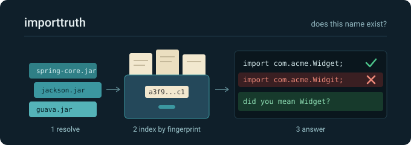

<div align="center">
  
</div>

# importtruth

Your coding agent keeps importing classes that do not exist. importtruth is
the friend who has actually read the libraries and says so, politely but
firmly, before the build has to.

It reads your project's real dependency JARs, writes down every public class
they offer, and answers one question over and over: does this name exist?
Java first.

## How it works (big picture)

1. **Resolve.** Ask Maven which exact library (JAR) files your project uses.
   Remember the answer. Ask again only when your build files change. No
   guessing, no "probably this version".
2. **Index.** Open each library once and write down every public class it
   offers, like an index at the back of a book. Each library is filed under
   the fingerprint (SHA-256) of its contents, so the same file is never
   indexed twice and a stale snapshot cannot sneak in.
3. **Answer.** When the agent writes code, check each import against the
   index. A real import passes silently. A fake import gets one short
   correction line naming the right class.

The tool never changes your project. It only reads. It never runs library
code either. It only reads the shape of it.

## Concepts you will keep meeting

- **ASM.** A small library that reads Java `.class` files without running
  them. Like a scanner, it sees names, signatures, and deprecation marks
  without waking the patient.
- **Code skipping.** A class file has declarations (names and signatures)
  plus the actual step by step instructions. We tell ASM to jump over the
  instructions, so indexing is fast, small, and provably never executes
  anything.
- **Content fingerprints.** Files are filed by content fingerprint, not by
  name or version number. Same content means same fingerprint, so duplicates
  and stale snapshots stop being a problem.
- **Single flight.** If five checks ask for the same library at once, only
  one of them does the indexing work and the other four wait for the result.
  Teamwork, enforced by a hash map.
- **MCP server.** The way the tool talks to the agent: short questions and
  answers over a standard channel (standard input and output). Logs always go
  to the error channel so they never corrupt the conversation.
- **Shaded (fat) JAR.** The final deliverable: all our boxes plus their
  libraries packed into one file, so it runs anywhere with one command.
- **Daemon (later).** A background helper that keeps the warm index in
  memory, so repeated checks skip the startup cost. Thin clients talk to it
  over local network with a secret token file.
- **Policy packs.** Small rule files for big migrations, e.g. Jackson 2 to 3
  or old `javax` names to new `jakarta` names. Rules only fire after the
  existence check passes, so a missing class is never misreported as a style
  problem. Each rule proves its replacement target really exists in your
  actual libraries, or it disables itself rather than bluff.
- **Source names.** A nested type is `Outer.Inner` in your code and
  `Outer$Inner` in the class file. The index stores the name you write,
  because that is the name you can paste into an import. Lookups accept
  either spelling, and a top level class whose own name holds a dollar
  sign keeps it.
- **Types, not members.** A suggestion is always a type you can import.
  Methods, fields and constructors never appear as import candidates,
  and a wildcard import resolves only when the name is a type or a
  package that holds one.
- **One small file per library.** The index of a library is a single
  sorted file, checksummed with CRC32C, and it is read into memory once
  and searched there. A lookup touches no file at all: the tool can
  answer after the index file has been deleted. The whole index of a
  project costs about 11 MB of disk for 38 libraries.
- **Honest answers.** The tool never claims a class is missing when it
  could not look. A build that cannot consult the JDK API for the
  release in question answers `UNVERIFIED` instead of `NOT_FOUND`, and
  an import it could not disprove is a candidate, not a missing import.
- **A machine channel.** Every tool answers twice: short lines for the
  agent to read, and the same answer as structured content for a
  program to read, with the status, the confidence, the overload
  signature, and the suggestions.
- **One compiler for a batch.** A check of many files parses them all
  with one compiler task and one file manager, so the cost of the
  compiler is paid once per batch and not once per file.
- **A bundled table of the JDK's API.** The tool ships a generated table
  of what each JDK release documents, so it answers "does `java.util.List`
  exist in release 21" without a JDK on disk at all. One file of about
  318 KB covers the releases that the build JDK's own `ct.sym` documents,
  which is 8 to 26 on Temurin 26. A release the table does not cover
  falls back to the archive on disk, and a release nothing covers stays
  `UNVERIFIED`.
- **Resolved paths.** A path that looks like it is inside your project can
  be a link that points anywhere. The tool resolves the project root and
  the file before it compares them, so a junction cannot carry a read
  outside the project, and it reads the resolved path, so the file it
  checked is the file it read.
- **Reachability.** A class file records only symbolic references, so the
  tool can say which of your dependency JARs your compiled code actually
  names, and which are named only by another dependency. It cannot see
  reflection, `ServiceLoader`, a computed `Class.forName`, or resources,
  so a JAR with no references is a candidate to remove, never a verdict,
  and every such answer carries the caveat that says so.

## Boxes (modules)

- `importtruth-model`: data shapes only. Zero dependencies, by rule.
- `importtruth-policy`: migration rule packs and their validation.
- `importtruth-index`: library indexes filed by content fingerprint.
- `importtruth-adapter-java`: reads Java bytecode without running it.
- `importtruth-core`: the brain: resolve, index, lookup, check.
- `importtruth-mcp`: talks to the agent. Never touches libraries directly.
- `importtruth-cli`: startup and wiring. Builds the final one JAR.

## Build (needs JDK 21+)

```text
./mvnw -q -DskipTests package
```

On Windows use `mvnw.cmd` in place of `./mvnw`.

Slow tests (real Maven spawns, heavy fixtures) carry `@Tag("slow")`:
`mvn test` runs the fast loop only, `mvn verify` runs everything
including coverage gates.

A project with several modules needs its sibling snapshots
installed (`mvn install` once). Otherwise resolution fails loudly
rather than guessing. CI runs `install` for exactly this reason.
On a fresh machine the first lookup downloads our pinned Maven
plugin once, then stays offline; project dependencies are never
fetched on your behalf.

The build and the tool have to agree on the local repository, because
Maven 3.10 records the origin of a downloaded artifact under a key that
carries the repository URL while Maven 3.9 reads the plain repository
id, and a repository written by one is invisible to the other. The CI
job therefore sets `-Daether.system.trackingRepositoryKeyFunction=nid`
in `MAVEN_ARGS`, which covers the build and every spawned child, and
that is the key every Maven version reads. Set the same property when
your own build and the Maven on your PATH are not the same version.

Every module enforces coverage gates on `verify`: 95% line, 90% branch
(the `Main` wiring class is excluded. Everything else is tested). The
gates have already caught real bugs, so they stay.

Measured on this machine (Windows, 16 cores, Java 26): a warm check of one
file answers in 35 ms, and a check of the 93 files of this project takes
1.6 s, because a batch pays the compiler once instead of once per file.
The first call of a session costs about 1.2 s, spent on the cached
classpath, the bundled JDK table and the first sweep of the dependency
indexes. Resolution, indexes, parsed files and validated policy engines
are memoized per session, and the classpath cache is reused across
sessions until a pom changes. The JDK's own release index is cached on
disk too, so a session that starts fresh pays 38 ms for the releases the
bundled table does not cover instead of 137 ms.
Idle memory is about 67 MB with the launch flags below, and a full check
of 93 files peaks at 99 MB, against 187 MB without the flags.
Idle CPU is 0.02 percent of sixteen cores. Eight concurrent requests are
all answered in 637 ms, because resolution, the JDK API table and the
the dependency indexes are each loaded once no matter how many requests
arrive, and because the index is searched in memory rather than read from
disk. JDK answers come from the project's target release, never the running
JVM alone, so projects that target other releases get honest verdicts. The
release is answered from the bundled table, and from the running JDK's
`ct.sym` for the releases the table does not cover. Misses get ranked
suggestions: exact names first, then names from the same package, then
small typos, and only ever types.

A slow test enforces the budget, so a regression fails the build instead
of being noticed months later: the 93 file check under 8 s, the index
under 200 bytes per symbol, the server's working set under 160 MiB idle
and 224 MiB under a burst of eight concurrent requests.

On a machine that has never built the project, the dependencies are not in
the local Maven repository yet, and the tool will not fetch them for you.
It says so plainly and names the build that fetches them. Only the pinned
Maven plugin of our own is ever downloaded, once, and only when the plugin
cache is cold.

## Enforcement

After edits, an opencode plugin runs the check and reports findings back
into the session. Install it and point it at the shaded JAR:

```text
opencode plugin: opencode-plugin/importtruth.ts
IMPORT_TRUTH_JAR=<path>/importtruth-cli-0.5.0.jar
```

For a small footprint, start the server with a capped heap and the
serial collector:

```text
java -Xms32m -Xmx96m -XX:+UseSerialGC -XX:MaxRAMPercentage=10 -Xss256k -XX:MaxMetaspaceSize=64m -XX:ReservedCodeCacheSize=16m -XX:ActiveProcessorCount=2 -XX:TieredStopAtLevel=1 -XX:CICompilerCount=2 -jar <path>/importtruth-cli-0.5.0.jar
```

Those flags are measured, not guessed. The serial collector alone is
worth 19 MB, because G1 pre-commits about 60 MB of collector
structures that a small heap never uses. Capping the code cache and
the metaspace, shrinking the thread stacks, and letting the JVM see
only two processors take the same work from 84 MB to 67 MB. C2 is
turned off on purpose: the hot path is one indexed query and one
parsed file, and the measured cost of C1 only is about 8 percent on a
large batch.

Nested Maven runs inherit a 512m cap unless MAVEN_OPTS is already set.

The resolver uses the system `mvn` by default, not the project's own
`mvnw.cmd`. A project's wrapper properties file can point a download at
any address it likes, and a wrapper is found by walking up the tree, so
an ancestor's wrapper could be picked up by accident. The project's
wrapper is used only when there is no system Maven, and only when it
sits inside the project that was asked about. The failure message always
names the launcher it tried.

A native image is the only way below 60 MB of resident memory, and one
builds with GraalVM 25 or later and the MSVC C++ toolchain:

```text
mvnw.cmd -Pnative package
```

The image is 44.3 MB and starts with no JVM at all: it answers its first
request 93 ms after it is started, and holds 45.5 MB of resident memory
while it works, under 60 MB. The image's heap is capped at build time,
because `native-image` sizes it ergonomically by default and the image's
collector does not hand memory back eagerly, so an uncapped image keeps
the footprint at its high-water mark, 76 MB here. The cap is the
`native.heap.max.bytes` property, so a project with a much larger index
can be given a bigger one. The image is a second artifact, not the
default: the shaded JAR stays what the plugin and the MCP configuration
use. A native image carries no JDK on disk, so it can read neither
`ct.sym` nor the runtime image filesystem. The native build carries the
bundled JDK API table, so an image answers the releases the table covers
and says `UNVERIFIED` for the ones it does not.

Direct check of files (exit 1 on missing imports, silent when clean):

```text
java -jar importtruth-cli/target/importtruth-cli-0.5.0.jar check <project> <file>...
```

Which dependency JARs your code actually references (exit 0 on success,
exit 1 on failure). The project must have compiled classes, in
`target/classes` or `target/test-classes`:

```text
java -jar importtruth-cli/target/importtruth-cli-0.5.0.jar deps <project>
```

A sample hook config lives in `.pre-commit-config.yaml`. The MCP server
additionally exposes `lookup_symbol`, `search_api`, and `check_file`
under `mcp.servers` for checks driven by the model, plus batch variants
`lookup_symbols` and `check_files` (up to 50 items per call) for
sweep phases where round trips dominate. `suggest_imports` ranks
dependency names for wanted imports with case insensitive matching,
up to 50 names per call and 5 suggestions per name by default.
`analyze_dependencies` reports which dependency JARs your compiled code
references, which are named only by another dependency, and which no
reference reaches, with the caveat that a class file scan cannot see
reflection, `ServiceLoader`, a computed class name, or resources.

## Status

Shipped in 0.3.0: batch tools (`lookup_symbols`, `check_files`),
warm checks under a second, ranked suggestions, JDK answers for every
target release.

Shipped in 0.5.0: nested types resolve under the name you write,
suggestions offer only importable types, batch calls can no longer
forge a verdict line, nested Maven modules join the classpath, and the
resolver tells a cold plugin cache apart from a project that was never
built here. The index became one small checksummed file per library,
read into memory, so a lookup touches no file and the whole index of a
project costs about 11 MB. A check of many files now pays the compiler
once, not once per file. The tool answers twice, in lines and in
structured content, and it never claims a class is missing when it could
not look. Concurrent requests no longer kill the session. It now carries a
bundled table of the JDK's API, so it answers JDK questions with no JDK
on disk. Paths are resolved before they are compared, so a link cannot
carry a read outside the project. A new `analyze_dependencies` tool and a
`deps` command report which dependency JARs your code actually
references. A slow test enforces the memory and time budget. Coverage
gates green on all 7 modules. Daemon deferred: sharing is safe by
construction, and answers in the same process are already fast.
